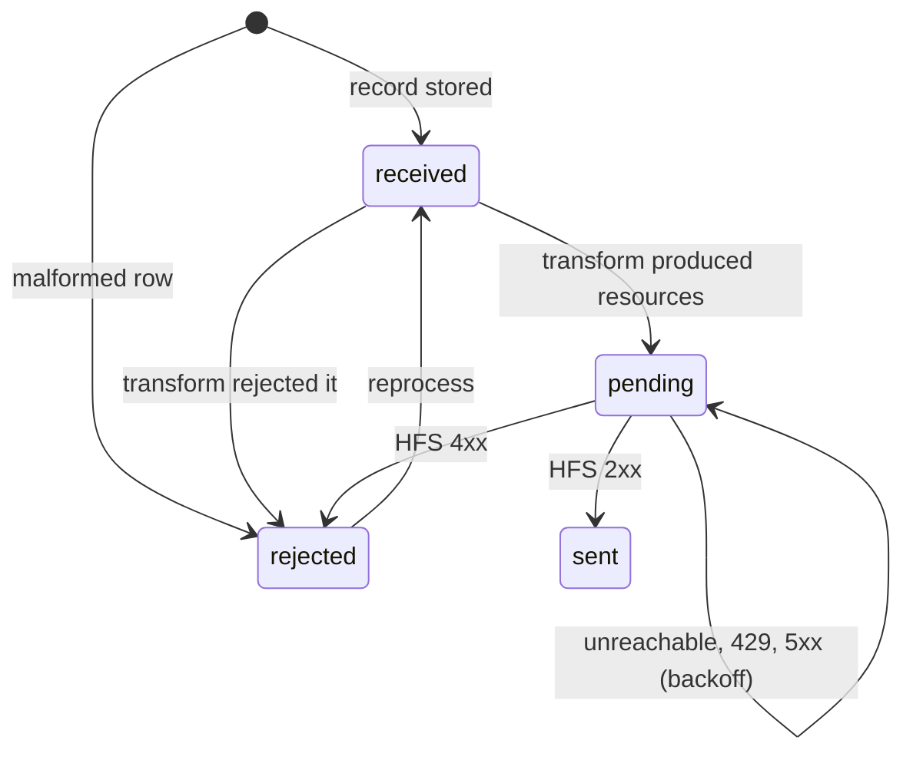

# Helios Integration Engine: Architectural Discussion

## Introduction

A FHIR server is only as useful as the data inside it. The [persistence layer discussion](https://github.com/HeliosSoftware/hfs/discussions/28) and the [bulk export discussion](https://github.com/HeliosSoftware/hfs/discussions/104) cover how HFS stores data and how data leaves it in volume. This document is about the step before both: how data from the outside world, in whatever shape it arrives, becomes FHIR resources in HFS, reliably, with a record of what happened to every row, and with someone told when it stops arriving.

That is the job of the Helios Integration Engine (HIE). It is a separate service that sits between the systems that produce data (a laboratory information system dropping files in a bucket, a database, another FHIR server) and HFS. It is also what the client applications built on HFS call into to see where their data came from and whether it is fresh.

Like the discussions linked above, this is an architectural strategy document rather than a specification. It explains the building blocks, the technology choices we propose for each, and the Rust trait designs that will shape the engine. It is informed by two things: a hands-on comparison of two integration engines (Apache Camel and the Open Integration Engine, the open-source fork of Mirth Connect), and a working prototype in this repository that already takes a CSV from a folder to `Observation` resources in HFS through the full error, retry and alerting path.

**Who should read this?** Anyone who has had to get a hospital's data into a FHIR server and keep it flowing: integration analysts, data engineers, and the people who get paged when the Tuesday file has seven columns instead of six. Feedback is very welcome.

**A note on scope.** This document covers getting data *into* HFS. Outbound integration (sending FHIR data to other systems) is a separate problem. Visual channel authoring, no-code data preparation and a catalog of hundreds of SaaS connectors, which commercial integration platforms sell, are explicitly not goals.

---

## The Lay of the Land: What an Integration Engine Is

Every integration product, from a 2007 open-source engine to a cloud provider's managed service, decomposes into the same handful of blocks. We built the same lab-results flow in two of them and broke it on purpose; the blocks, and what each product did with them, were:

| Block | What it does | What we saw |
|---|---|---|
| **Source** (connector, listener, reader) | Notices that new data exists and reads it | Both engines poll a folder; both choked on a UTF-16 file, and one retried it forever |
| **Queue** | Holds work durably between steps, so an outage or a crash loses nothing | Every mature engine has a persistent queue. The one without it sent a good file to an error folder when the destination was down, and nobody re-sent it |
| **Transform** | Turns a source record into FHIR | Text templating let a bad value reach the server; a scripted transform that builds objects rejected it with the exact reason before sending |
| **Delivery** (sender, destination) | Writes to the target, here HFS | Re-sending a file doubled the data in both engines. A row that kept failing re-wrote its good neighbours every half second: 20 copies in 10 seconds |
| **Monitoring** | Per-record history: what arrived, what was sent, what the target answered | The single most useful feature either engine had was a per-message history with a reprocess button |
| **Alerting** | Telling a person | Neither engine could say "nothing has arrived from the lab since Tuesday" |

Three conclusions shape everything below.

**Idempotency is the first requirement, not a feature.** Sources re-send files. Operators re-run jobs. Networks deliver twice. Unless every resource carries a stable business identifier and delivery is a conditional update, the FHIR server fills with duplicates, and the analysis built on top of it is wrong in ways nobody notices.

**Data errors and transient errors are different problems.** A non-numeric value, an unknown code, a 400 from HFS: no retry will fix these. They go to a dead letter with the file, the line and the reason, and wait for a person. An unreachable HFS, a 503, a timeout: these are retried with backoff and never dropped. An engine that treats both the same either multiplies writes or stops good data.

**The queue is not something to build.** Steve's framing is right: integration engines have a heavy persistent-queue capability, and we should not rebuild it. But "queue" means two different things at two scales, and the right answer differs for each (see the deployment section).

---

## The Essential Flow

The shape of every feed, regardless of source or target, is the same. Following one record, a line in a lab CSV, through the prototype:

1. **Arrival.** The source is polled (or notifies). A new object appears: a file in a folder, an object in a bucket.
2. **Admission.** The object's content hash is checked against what was already received; an identical object is recorded as a duplicate and not reprocessed. The object is decoded (UTF-8, with or without a byte-order mark, and UTF-16) and split into records. Each record is stored with the object's name, hash and its own line number, in state `received`. Only then is the object archived. From this point the engine's store, not the source, is the source of truth: a crash or an HFS outage loses nothing.
3. **Transform.** Each record is handed to the feed's transform, which returns zero or more FHIR resources or rejects the record with a reason. A rejected record goes to `rejected` with that reason. A transformed one goes to `pending`.
4. **Admission to delivery.** The engine checks only what it relies on: a `resourceType`, and an `identifier` with system and value. Without the identifier there is no idempotency, so the record is rejected.
5. **Delivery.** Pending records are sent to HFS. The two delivery paths are described below. Each resource is written as a conditional update on its identifier, so the first delivery creates and any later one updates.
6. **Disposition.** A 2xx marks the record `sent` with HFS's response (location, version). A 4xx marks it `rejected` with the `OperationOutcome` text. A connection failure, 429 or 5xx leaves it `pending` with a next-attempt time that doubles each try up to a ceiling, and raises one outage alert after a configured number of attempts and one recovery alert when delivery resumes.
7. **Completion.** When every record of an object is `sent` or `rejected`, the object is `done`. If any were rejected, one alert names the object, the count and the first reason.
8. **Freshness.** Independently of any object, each feed declares how often it expects data. When nothing has arrived for longer than that, one silence alert is raised, and not repeated until data flows again.

A `rejected` record can be put back to `received`, optionally with a corrected row; the original row is kept alongside the correction. This is the reprocess button.



---

## The First Use Case: A Bucket into HFS

The concrete goal for the first version is narrow on purpose: a data set lands in an S3 bucket, and it is ingested into HFS with confidence. "With confidence" means every one of the properties above holds: nothing lost, nothing duplicated, every rejection explained, and a person told.

Two delivery paths exist, and the choice should be a per-feed setting rather than an architectural commitment.

**REST, batch Bundles.** The engine builds `batch` Bundles of conditional `PUT` entries (`PUT Observation?identifier=system|value`) and posts them to `[base]/`. HFS supports conditional update inside Bundles today; the prototype verified 201 on first delivery and 200 on re-delivery. A batch, unlike a transaction, returns a status per entry, so one bad row does not block its neighbours. This path suits feeds of hundreds to tens of thousands of records at a time, and anything that needs an answer per record.

**`$bulk-submit`.** HFS implements the Bulk Data Submit operation as the Data Consumer: a client posts `$bulk-submit` with a manifest URL, and HFS fetches the manifest and its NDJSON files, ingests them through its bulk engine, and exposes a status manifest with a receipt per resource. For a bucket feed this is a natural fit: the engine transforms records to NDJSON, writes the files and a manifest back to object storage, and hands HFS pre-signed URLs. HFS's bulk path has the fast-load behaviours already measured in the HFS repository (deferred indexing, skip-unchanged replay, lease-based workers), and its `import-mode` directive (`replace` or `merge`) covers how a re-submitted resource is applied. This path suits large initial loads and nightly extracts. The engine's job is then to produce the files, kick off the submission, poll the status manifest, and map each receipt back to its record so the per-record history is as complete as on the REST path.

The identifier discipline is the same on both paths. On `$bulk-submit`, HFS upserts by resource `id`, so the engine must assign deterministic ids derived from the business identifier (a UUID v5 of `system|value` is enough), or the first path's conditional update must be used. This is the one place where the two paths differ in mechanism, and it is confined to the delivery trait.

---

## The Architectural Tensions

**Business keys come from the source, or not at all.** Idempotency needs a key that identifies the same real-world event every time it is sent: an accession number plus a test code, an encounter identifier, a message control id. The prototype's example key (`patient|code|date`) is a placeholder that would merge two same-day results. Every feed definition must say where its key comes from, and a transform that cannot produce one must reject the record rather than invent one.

**Transform isolation against throughput.** A transform written by an analyst can hang, crash or loop. Running it in the engine's process means it can take the engine down; running it in a separate process costs a round trip per record. The prototype runs a long-lived Python worker per feed and exchanges one JSON line per record; at lab volumes the cost is invisible, and the protocol can carry batches when it is not.

**One Python runtime, or a shared one.** Transforms are Python. The analytics side of the product also runs Python. Steve's suggestion that this become one shared service both halves call into is worth pursuing: the engine's transform protocol is already a request/response over JSON, so the worker can be a subprocess today and an HTTP or queue-backed service tomorrow without changing the trait. The decision can wait until the shared service exists; the engine should not block on it.

**Run it yourself against run it managed.** HFS made a choice that worked: the same trait surface serves an embedded single-instance deployment and a fleet, and the operator picks. The engine should do the same. The risk Steve named, spending years on thin layers over every cloud product, is real; the defence is to keep the set of pluggable points small (source, store, notifier, delivery) and to ship one embedded implementation and one managed implementation of each, no more.

**How deep to go.** What we will not build: visual channel design, drag-and-drop mapping, no-code data preparation, a catalog of SaaS connectors, CDC replication, stream processing. Those are products. What we will build is the thin, reliable path from a handful of source types to HFS, with the operational properties above. Anyone who needs Kafka in the middle can put it there; the engine reads from a queue as readily as from a bucket.

---

## Single-Instance vs Multi-Instance

### Single instance: zero configuration

One process. Sources are polled. The record store is an embedded SQLite file in WAL mode, which is both the queue and the history. Transform workers are subprocesses. Delivery happens in-process. The API and metrics are served by the same process. This is the prototype, and it is what every developer, every demo and every single-VM customer runs.

### Multi instance: shared state, work pool

Several engine instances, possibly a separate worker tier. The record store is PostgreSQL, which is also the planned store for the rest of the product. The queue is a table: workers claim records with `SELECT ... FOR UPDATE SKIP LOCKED` under a lease with a heartbeat, the same claim strategy the bulk export discussion proposes for HFS, and for the same reason. Object sources are read from S3. Arrival can be notified instead of polled: an S3 event to SQS or EventBridge wakes a worker, with polling kept as the safety net. The Python runtime may be the shared service.

A table-as-queue in PostgreSQL carries a lab's volumes comfortably and keeps the queue and the history in one transaction, which a separate broker cannot. SQS fits as the *notification* channel, where at-least-once delivery and a visibility timeout are exactly what is wanted, rather than as the record queue. Kafka and NATS are not proposed: the workloads here are files and batches, not streams, and the operational cost is not justified by the first several customers.

The point, as with HFS, is that the handler code does not change between the two. The traits below are designed so that the embedded and the managed implementations are the only things that differ.

---

## The Recommendation

| Concern | Embedded default | Managed variant | Why |
|---|---|---|---|
| Source | Local folder | S3 bucket | HFS already carries the AWS S3 SDK; the first use case is a bucket |
| Arrival | Polling with a file-age guard | S3 event to SQS, polling as fallback | Notification cuts latency; polling catches what notification missed |
| Record store and queue | SQLite, WAL | PostgreSQL, `SKIP LOCKED` leases | One transaction for queue and history; same claim strategy as HFS bulk jobs |
| Transform runtime | Python subprocess per feed, JSON lines | Shared Python service over the same protocol; a serverless function is possible since the protocol is plain JSON | Isolation now, consolidation later, no trait change |
| Delivery | REST batch Bundles | `$bulk-submit` with files on S3 | Per-feed choice by volume and latency |
| Identity | OIDC client credentials to HFS; bearer validation on the engine's API | Same | Reuse `helios-auth`; the engine must not be an anonymous writer |
| Monitoring | Prometheus `/metrics`, OTLP traces | Same, scraped by whatever watches HFS | One monitoring stack for the whole deployment |
| Alerting | Stored alerts plus a webhook (Slack, Teams, a pager) | An alerting product behind the webhook | Routing, escalation and on-call belong to a product and to the identity provider |

What is deliberately left out of the table: a message broker between steps, a workflow orchestrator, and a visual designer.

---

## Designing the Rust Traits

The prototype implements these as concrete types in one crate. This section proposes the trait surface that lets each concrete type be replaced. Names are proposals.

### Types

```rust
/// A configured feed: one source, one transform, one delivery path.
pub struct FeedId(pub String);

/// One unit of input: a file, an object, a message. Immutable once admitted.
pub struct SourceObject {
    pub feed: FeedId,
    /// Stable within the source: a path, an object key, a message id.
    pub key: String,
    pub bytes: Vec<u8>,
    pub sha256: [u8; 32],
    pub received_at: DateTime<Utc>,
}

/// One record cut from a source object, with enough context to be named
/// to a human ("line 3 of labs.csv").
pub struct SourceRecord {
    pub object_id: ObjectId,
    pub line: u64,
    pub raw: serde_json::Value,
}

pub enum RecordState {
    Received,
    Pending { attempts: u32, next_attempt_at: DateTime<Utc> },
    Sent { response: serde_json::Value },
    Rejected { kind: RejectionKind, reason: String, response: Option<serde_json::Value> },
}

pub enum RejectionKind {
    /// Could not be cut into fields: wrong column count, undecodable.
    Parse,
    /// The transform said the data is wrong.
    Data,
    /// The transform itself failed; kept with its trace.
    Transform,
    /// The engine's own check: no resourceType, no identifier.
    Validation,
    /// HFS answered 4xx for this entry.
    Server,
}

/// What a transform makes of one record.
pub enum TransformOutcome {
    Resources(Vec<serde_json::Value>),
    Rejected { kind: RejectionKind, reason: String },
}

/// Why a delivery attempt did not succeed as a whole.
pub enum DeliveryError {
    /// Try again later: unreachable, timeout, 429, 5xx.
    Transient(String),
    /// The target refused the request itself.
    Refused { status: u16, body: serde_json::Value },
}
```

### Source

A source lists what is new, fetches it, and acknowledges it once admitted. Polling and notification are both expressed through `wait`: the folder implementation sleeps for the poll interval, the S3 implementation waits on an SQS receive with the poll interval as a timeout.

```rust
#[async_trait]
pub trait Source: Send + Sync {
    /// Blocks until there may be new objects, or the interval elapses.
    async fn wait(&self) -> Result<()>;

    /// Keys of objects not yet acknowledged, oldest first. Must be safe to
    /// call repeatedly: an object listed twice is admitted once by its hash.
    async fn list(&self) -> Result<Vec<String>>;

    async fn fetch(&self, key: &str) -> Result<SourceObject>;

    /// The object has been stored record by record. Move it out of the way
    /// (archive prefix, processed folder, message delete).
    async fn acknowledge(&self, key: &str) -> Result<()>;
}
```

Implementations: `FolderSource` (prototype), `S3Source` (first use case), later `FhirSource` (another FHIR server, driven by `$export` or history) and `DatabaseSource`.

### Reader

Cutting an object into records is independent of where the object came from. A reader never fails an object because of one row.

```rust
pub trait Reader: Send + Sync {
    fn read(&self, object: &SourceObject) -> Result<Vec<ReadRecord>>;
}

pub struct ReadRecord {
    pub line: u64,
    pub raw: serde_json::Value,
    /// Set when the row could not be cut: it is stored and rejected, and
    /// the rest of the object proceeds.
    pub parse_error: Option<String>,
}
```

Implementations: `CsvReader` (prototype), `NdjsonReader` (bulk feeds, FHIR sources), later `Hl7v2Reader`.

### RecordStore

The store is the queue, the history and the coordination point. Everything the API serves comes from it, and everything a worker does goes through it. The multi-instance implementation adds leases; the single-instance one satisfies them trivially.

```rust
#[async_trait]
pub trait RecordStore: Send + Sync {
    async fn find_object_by_hash(&self, feed: &FeedId, sha256: &[u8; 32]) -> Result<Option<ObjectId>>;
    async fn admit_object(&self, object: &SourceObject, records: &[ReadRecord]) -> Result<ObjectId>;

    /// Claims up to `limit` records in `Received`, for this worker, under a lease.
    async fn claim_received(&self, feed: &FeedId, worker: &WorkerId, limit: usize) -> Result<Vec<SourceRecord>>;
    /// Claims up to `limit` records in `Pending` whose next attempt is due.
    async fn claim_due(&self, feed: &FeedId, worker: &WorkerId, limit: usize) -> Result<Vec<PendingRecord>>;
    async fn heartbeat(&self, worker: &WorkerId) -> Result<()>;

    async fn set_state(&self, record: RecordId, state: RecordState) -> Result<()>;
    /// Back to `Received`, keeping the original row when a correction is supplied.
    async fn reprocess(&self, record: RecordId, corrected: Option<serde_json::Value>) -> Result<bool>;

    /// Objects whose records are all terminal, marked done and returned once.
    async fn complete_objects(&self, feed: &FeedId) -> Result<Vec<ObjectSummary>>;
    async fn last_received_at(&self, feed: &FeedId) -> Result<Option<DateTime<Utc>>>;

    async fn record_alert(&self, alert: &Alert) -> Result<AlertId>;
    async fn last_alert_at(&self, feed: &FeedId, kind: AlertKind) -> Result<Option<DateTime<Utc>>>;
}
```

Implementations: `SqliteStore` (prototype), `PostgresStore` (leases via `SKIP LOCKED`, the same shape as `BulkExportStorage` claims in HFS).

### Transformer

A transform is a function from one record to resources, run somewhere else. The trait hides where. A transformer failing (as opposed to rejecting a record) is a transient condition: the record stays claimed and is retried.

```rust
#[async_trait]
pub trait Transformer: Send + Sync {
    async fn transform(&self, record: &SourceRecord, context: &TransformContext) -> Result<TransformOutcome>;
}

pub struct TransformContext {
    pub feed: FeedId,
    pub object_key: String,
    pub line: u64,
}
```

Implementations: `PythonSubprocess` (prototype; JSON lines over stdin/stdout, restarted on failure), `PythonService` (the shared runtime over HTTP, same messages), later `FhirMappingLanguage`.

### Deliverer

Delivery takes a set of resources with their identifiers and returns a disposition per record. The two HFS paths are two implementations.

```rust
#[async_trait]
pub trait Deliverer: Send + Sync {
    async fn deliver(&self, batch: &[DeliveryItem]) -> Result<Vec<Disposition>, DeliveryError>;
}

pub struct DeliveryItem {
    pub record: RecordId,
    pub resource_type: String,
    pub identifier: (String, String),
    pub resource: serde_json::Value,
}

pub enum Disposition {
    Sent(serde_json::Value),
    Rejected { status: u16, body: serde_json::Value },
    Transient { status: u16, body: serde_json::Value },
}
```

Implementations: `RestBatchDeliverer` (prototype: conditional `PUT` entries in a `batch` Bundle; a refused Bundle is re-sent one item at a time to isolate the bad one), `BulkSubmitDeliverer` (writes NDJSON and a manifest to object storage, posts `$bulk-submit`, polls the status manifest, maps receipts to records).

### AlertSink

```rust
#[async_trait]
pub trait AlertSink: Send + Sync {
    async fn raise(&self, alert: &Alert) -> Result<()>;
}

pub enum AlertKind { RejectedRecords, UnreadableObject, DeliveryOutage, DeliveryRecovered, Silence }
```

The engine decides *when* (once per condition, with recovery) and *what* (feed, object, count, first reason). The sink decides *where*: the log, a webhook, later a product. Who is on call is not the engine's concern.

### The runner

One `FeedRunner` per feed ties the traits together in a loop whose steps each pick up what the previous pass left: wait on the source, admit new objects, transform claimed records, deliver due records, complete objects, check silence. A step that fails is simply retried on the next pass, which is what makes the loop safe to restart at any point. In a multi-instance deployment several runners for the same feed coexist because every claim goes through the store's lease.

---

## The API

The engine's HTTP API is what a client application calls to render a data-sources page, and what an operator uses to find and fix a rejected row.

| Resource | Purpose |
|---|---|
| `GET /api/feeds` | Each feed with its freshness (`ok`, `silent`, `no_data_yet`), counts by state, last object, last alert |
| `GET /api/feeds/{id}/objects` | Objects received, duplicates marked, per-object sent and rejected counts |
| `GET /api/records?feed=&status=&object=` | Records, filterable |
| `GET /api/records/{id}` | One record: object, line, original and corrected row, resources sent, target response |
| `POST /api/records/{id}/reprocess` | Back to the start, optionally with a corrected row |
| `GET /api/alerts` | Alerts, newest first |
| `GET /metrics` | Prometheus: records by state per feed, last-received timestamp per feed, alerts by kind |

The API is protected by the same bearer-token validation HFS uses, from `helios-auth`.

---

## Configuration: What Operators Will Touch

An engine configuration names HFS, the store, the listen address, the transform runtime and the alert webhook. A feed is one file:

```yaml
id: lab-results
name: Lab results
source:
  type: s3                      # or folder
  bucket: lab-feeds
  prefix: results/
  notify: sqs://lab-feeds-arrivals   # optional; polling otherwise
format: csv                     # or ndjson
transform: transforms/lab_results.py
delivery:
  method: rest                  # or bulk-submit
  batch_size: 100
  initial_backoff: 2s
  max_backoff: 5m
  alert_after_attempts: 5
expect_every: 24h
```

Feeds and transforms are files under version control. Mapping rules are agreements with a data source; they deserve history and review. A UI that edits them should do so through an API that writes these files, not around them.

Environment variables follow the HFS convention: `HIE_CONFIG`, `HIE_LOG`, `HIE_RUNTIME_DIR`, and later `HIE_STORE_URL`, `HIE_AUTH_*`.

---

## Authorization

The engine is a client of HFS and a server to its own API, and both sides use the identity provider.

- **To HFS:** a confidential client with its own credentials (SMART Backend Services, `client_credentials` with `private_key_jwt`), requesting `system/*.write` or the narrower scopes a feed needs, plus `system/bulk-submit` on the bulk path. Tokens are cached and refreshed per feed.
- **Its own API:** bearer tokens validated against the identity provider's JWKS, reusing `helios-auth`. Reading feed status and reprocessing a record are different permissions.

The engine never runs as an anonymous writer, and a feed's identity in HFS audit events should be the feed's client, not a shared service account.

---

## What's Not in Scope (Yet)

- **HL7v2 input.** Most laboratory interfaces speak ORU over MLLP. It is the next reader and source after S3, and the one place where the engines we tried have a genuine head start.
- **Code translation inside transforms** through HTS (`ConceptMap/$translate`). The example transform carries a local code table; the real one calls HTS.
- **Patient matching.** A source identifier (an MRN) must become a `Patient` reference. This is its own design problem.
- **Profile validation before delivery** through HFS `$validate`.
- **FHIR Mapping Language** as a second transform runtime.
- **Outbound integration**, CDC, streaming, visual authoring.

---

## Proposed Next Steps

1. **Ship the embedded default against the first use case.** `S3Source`, `NdjsonReader` alongside the CSV reader, `RestBatchDeliverer` as it is, and the data set in the bucket ingested into HFS end to end, with the API showing every record.
2. **Add `BulkSubmitDeliverer`.** NDJSON and manifest to S3, `$bulk-submit` kick-off, status polling, receipts mapped to records. Measure the two paths on the same data set.
3. **Extract the traits above** from the prototype's concrete types; keep the end-to-end test green through the refactor.
4. **Authentication.** Client credentials to HFS; bearer validation on the API.
5. **`PostgresStore` with leases**, with a testcontainers integration test that runs two runners against one feed.
6. **S3 event notification through SQS**, with polling as fallback.
7. **Decide the shared Python runtime** with the analytics side, and add `PythonService` behind the same protocol if it goes that way.
8. **HL7v2 reader and MLLP source.**

---

## Closing Thoughts

The products in this space are large because they try to be the whole pipeline for every industry. What a FHIR platform needs from an integration engine is narrower and harder to get right: a short, dependable path from a few kinds of source into the server, where nothing is lost, nothing is duplicated, every rejection can be explained to the person who owns the data, and silence is noticed.

The trait surface proposed here is small on purpose: a source, a reader, a store, a transformer, a deliverer, an alert sink. Each has one embedded implementation and one managed implementation, and the runner does not know which it holds. That is the same bet HFS made with its persistence layer, and it is what lets the same engine run on a laptop against SQLite and in a fleet against PostgreSQL, S3 and a shared transform service without rewriting the loop in the middle.

Thank you for reading. Feedback, objections and better names are all welcome.

- Angela
